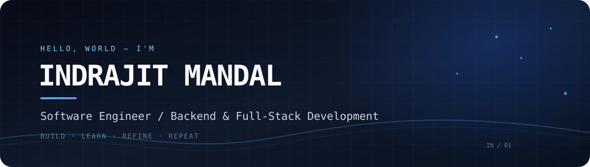

<!--
  GitHub Profile README
  Repository: https://github.com/IndrajitSir/IndrajitSir
  Keep project links and technology claims aligned with the current repositories.
-->

  

  
  

<h3 align="center">Software Engineer · Backend & Full-Stack Development</h3>

  Building useful software, exploring how systems work, and learning by shipping.

  

---

## `whoami`

I'm **Indrajit Mandal**, a software engineer interested in building dependable applications and understanding the engineering behind them.

- 💼 Working at **Distronix**
- 🎓 **BCA graduate** — CGPA: **8.14**
- 🧩 Interested in backend engineering, full-stack development and system design
- 🔐 Currently exploring cybersecurity, Linux, networking and web application security
- 📦 Building reusable developer tools and experimenting with open-source projects
- 🚀 Long-term ambition: build products that solve meaningful problems

> I enjoy going beyond making an application work — understanding its architecture, security, performance and maintainability matters too.

## `selected_work`

A few projects and engineering experiments I enjoy working on:

| Project | What it is | Stack / focus |
|---|---|---|
| **Campus Placement Portal** | A role-based recruitment platform with placement workflows, applications and collaborative interview features. | React, Node.js, Express, MongoDB |
| **AlertifyX** | Android notification-based keyword alarm application, previously developed as WhatsAlarm. | Kotlin, Android |
| **NestJS Authorization Libraries** | Reusable authorization packages exploring resource/action permissions and role-based access control. | NestJS, TypeScript |
| **Grapify** | Interactive graph visualization and manipulation application. | React Flow, Spring Boot, MySQL |
| **OmniScript** | Developer utility platform and experiments around reusable tool templates. | React ecosystem, web tooling |
| **ResQ-Go** | Emergency assistance / ambulance-booking product. | Web application development |

Explore my repositories: **[github.com/IndrajitSir](https://github.com/IndrajitSir?tab=repositories)**

## `toolbox`

### Languages

  

### Frontend

  

### Backend & data

  

### Infrastructure & tools

  

## `github_activity`

  
  

  

  

## `currently_exploring`

- Linux internals, shell tooling and system administration
- Web application security and practical cybersecurity labs
- Networking fundamentals and infrastructure
- Docker, containers and deployment workflows
- Scalable backend architecture, API design and system design

## `connect`

  
  

  Thanks for stopping by. Feel free to explore, learn, and build alongside me. 
  <strong>Build with curiosity. Engineer with intent.</strong>

